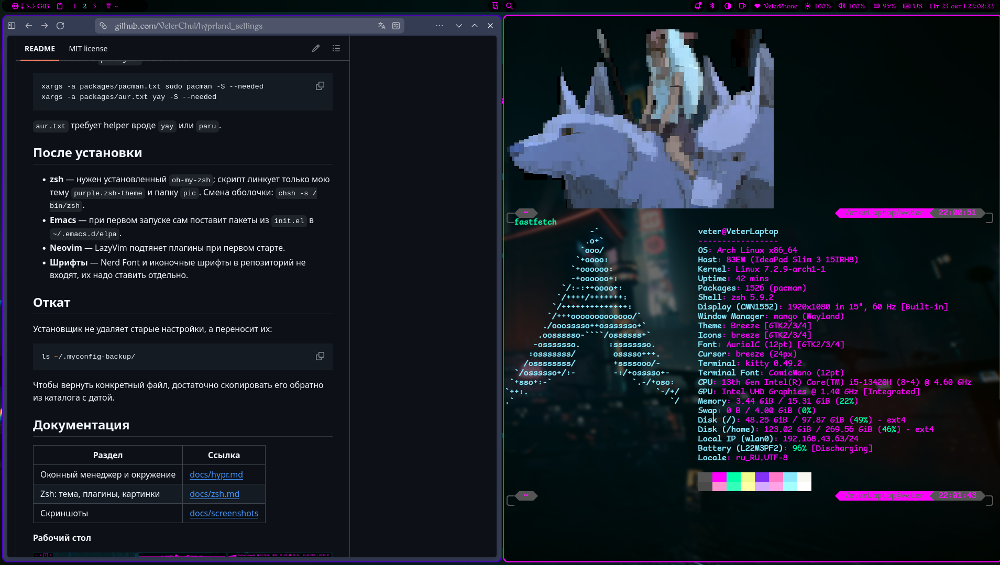
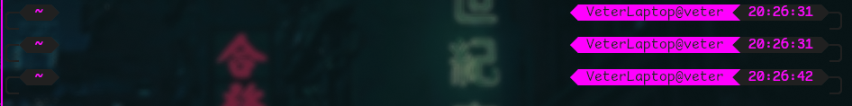
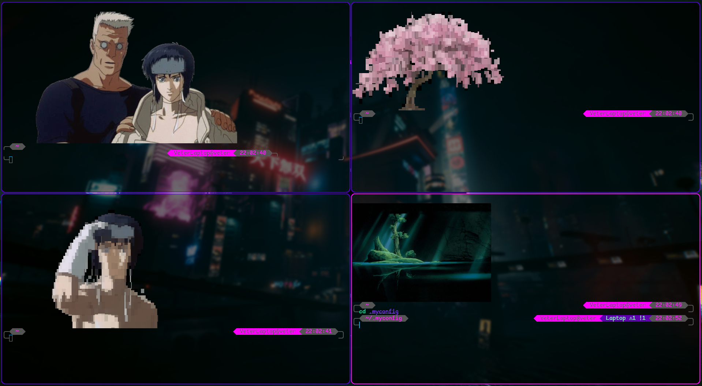

# .myconfig


Мои конфиги для Linux-окружения: оконный менеджер, панель, оболочка, редакторы и мелочи вроде скинов Audacious. Всё лежит в одном git-репозитории и раскладывается по системе симлинками, поэтому любая правка сразу попадает в историю.

Основная сессия — **Mango + Noctalia**. Конфиг Hyprland остаётся рядом как запасной вариант.

## Структура

```
~/.myconfig/
├── home/       # -> ~
├── config/     # -> ~/.config
├── local/      # -> ~/.local/share
├── docs/       # документация и скриншоты
├── packages/   # списки пакетов pacman и AUR
└── install.sh  # установщик
```

| Каталог | Куда попадает | Что внутри |
|---|---|---|
| `home/` | `~` | zsh (`.zshrc`, `.p10k.zsh`, темы oh-my-zsh), Emacs (`~/.emacs.d` по частям) |
| `config/` | `~/.config` | оконные менеджеры, панели, терминалы, редакторы |
| `local/` | `~/.local/share` | скины Audacious, cool-retro-term |
| `docs/` | — | README модулей, скриншоты |
| `packages/` | — | `pacman.txt`, `aur.txt` |

### Как именно линкуется

Каталоги `config/` и `local/` подключаются **по одному элементу на папку**:

```
~/.config/nvim           -> ~/.myconfig/config/nvim
~/.local/share/audacious -> ~/.myconfig/local/audacious
```

Никакого `~/.config -> ~/.myconfig/config` — иначе репозиторий подменил бы весь каталог настроек.

`home/` линкуется **по файлам и отдельным папкам**, потому что рядом с конфигами живёт рантайм:

```
~/.zshrc           -> ~/.myconfig/home/zsh/.zshrc
~/.emacs.d/init.el -> ~/.myconfig/home/.emacs.d/init.el
~/.emacs.d/modules -> ~/.myconfig/home/.emacs.d/modules
```

Если слинковать `~/.emacs.d` целиком, в репозиторий начнут писаться `cache/`, `eln-cache/`, `tramp/`, `transient/`. Поэтому — только перечисленные элементы. `elpa` тоже не версионируется: пакеты ставит `package.el`.

## Что настраивает репозиторий

| Компонент | Назначение | Путь в репо |
|---|---|---|
| Mango | оконный менеджер, основная сессия | `config/mango` |
| Noctalia | панель и шелл для Mango | `config/noctalia` |
| Hyprland | оконный менеджер, запасной конфиг | `config/hypr` |
| Waybar | статус-бар для Hyprland | `config/waybar` |
| Mako | всплывающие уведомления | `config/mako` |
| Rofi | лаунчер и меню | `config/rofi` |
| Kitty | терминал | `config/kitty` |
| eDEX-UI | терминал в стиле sci-fi | `config/eDEX-UI` |
| cool-retro-term | ретро-терминал | `local/cool-retro-term` |
| Flameshot | скриншоты | `config/flameshot` |
| hyprlock | экран блокировки Hyprland | `config/hyprlock` |
| swaylock | экран блокировки Mango | `config/swaylock` |
| Neovim | редактор, сборка на LazyVim | `config/nvim` |
| GNU Emacs | редактор, конфиг по частям | `home/.emacs.d` |
| Zsh | оболочка, oh-my-zsh, powerlevel10k | `home/zsh` |
| Audacious | плеер: конфиг и скины | `config/audacious`, `local/audacious` |

## Установка

```bash
git clone git@github.com:VeterChul/hyprland_settings.git ~/.myconfig
cd ~/.myconfig
./install.sh
```

Скрипт спросит: `Установить все конфиги? [Y/n]`. Пустой ввод — да, дальше проходит список без остановок. Если ответить `n`, спросит по каждому пункту отдельно.

Что делает установщик:

1. Проверяет, что рядом лежат `home/`, `config/`, `local/`.
2. Для каждого пункта создаёт симлинки.
3. Если на месте ссылки уже стоит реальный файл или каталог — переносит его в `~/.myconfig-backup/<дата>/` с сохранением путей.
4. Если стоит ссылка на другое место — просто заменяет её, без бэкапа.
5. Повторный запуск безопасен: корректные ссылки пропускаются.

## Пакеты

Списки лежат в `packages/`. Установка:

```bash
xargs -a packages/pacman.txt sudo pacman -S --needed
xargs -a packages/aur.txt yay -S --needed
```

`aur.txt` требует helper вроде `yay` или `paru`.

## После установки

- **zsh** — нужен установленный `oh-my-zsh`; скрипт линкует только мою тему `purple.zsh-theme` и папку `pic`. Смена оболочки: `chsh -s /bin/zsh`.
- **Emacs** — при первом запуске сам поставит пакеты из `init.el` в `~/.emacs.d/elpa`.
- **Neovim** — LazyVim подтянет плагины при первом старте.
- **Шрифты** — Nerd Font и иконочные шрифты в репозиторий не входят, их надо ставить отдельно.

## Откат

Установщик не удаляет старые настройки, а переносит их:

```bash
ls ~/.myconfig-backup/
```

Чтобы вернуть конкретный файл, достаточно скопировать его обратно из каталога с датой.

## Документация

| Раздел | Ссылка |
|---|---|
| Оконный менеджер и окружение | [docs/hypr.md](docs/hypr.md) |
| Zsh: тема, плагины, картинки | [docs/zsh.md](docs/zsh.md) |
| Скриншоты | [docs/screenshots](docs/screenshots) |

**Рабочий стол**



**Zsh**




## VeterDM

Отдельный проект — собственный display manager: [VeterChul/VeterDM](https://github.com/VeterChul/VeterDM). Хорошо дополняет эту сборку, если нужен графический вход в систему с тем же оформлением.

> Проект в бете и работает крайне нестабильно. Ставьте только если готовы разбираться с поломками и не боитесь остаться без графического входа.

## Лицензия

MIT. Сторонние компоненты сохраняют свои лицензии — подробности в [List_of_licenses.md](List_of_licenses.md).
